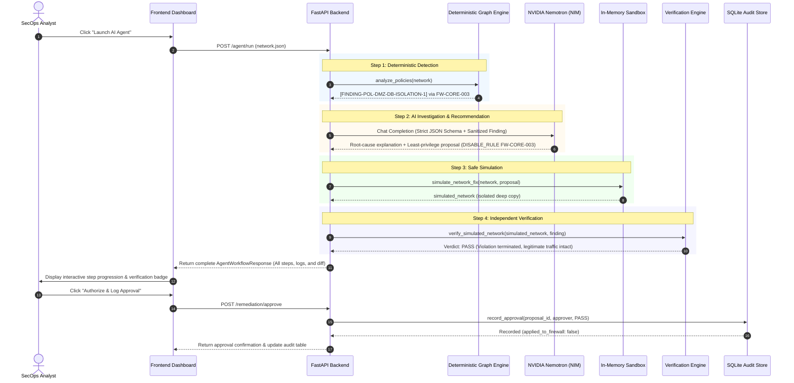
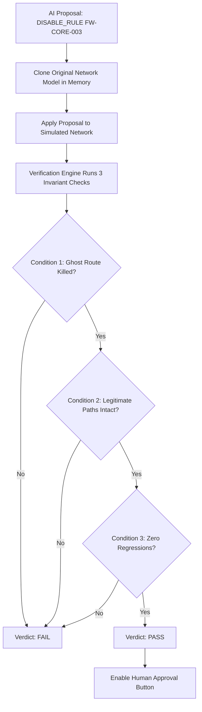

# GhostRoute AI — Autonomous Network Trust Path Investigator & Zero-Regression Remediation Platform

[](https://opensource.org/licenses/MIT)
[](https://www.python.org/)
[](https://fastapi.tiangolo.com)
[](https://react.dev/)
[](https://vitejs.dev/)
[](https://build.nvidia.com)
[-success.svg)](https://pytest.org)

**GhostRoute AI** is an enterprise-grade, simulation-first network security copilot. It models multi-tier hybrid network topologies, performs deterministic graph reachability analysis to discover shadow routes and policy breaches, uses **NVIDIA Nemotron** to identify root causes and formulate least-privilege remediation proposals, validates fixes in an in-memory sandbox with **independent 3-condition verification**, and enforces SecOps human authorization through an immutable audit trail.

```
┌──────────┐     ┌──────────────┐     ┌───────────┐     ┌───────────┐     ┌──────────┐     ┌──────────┐     ┌──────────┐
│  DETECT  │ ──► │  INVESTIGATE │ ──► │  EXPLAIN  │ ──► │ RECOMMEND │ ──► │ SIMULATE │ ──► │  VERIFY  │ ──► │ APPROVE  │
│ (Graph)  │     │  (Forensics) │     │ (Nemotron)│     │ (Proposal)│     │(Sandbox) │     │ (3-Cond) │     │ (Audit)  │
└──────────┘     └──────────────┘     └───────────┘     └───────────┘     └──────────┘     └──────────┘     └──────────┘
```

---

## Table of Contents
1. [Core Features & Value Proposition](#core-features--value-proposition)
2. [End-to-End System Architecture](#end-to-end-system-architecture)
3. [The 6-Step Autonomous Agent Workflow](#the-6-step-autonomous-agent-workflow)
4. [Project Structure](#project-structure)
5. [Frontend Application Architecture](#frontend-application-architecture)
6. [Backend & Graph Engine Architecture](#backend--graph-engine-architecture)
7. [NVIDIA Nemotron Integration & Fallback Safety](#nvidia-nemotron-integration--fallback-safety)
8. [Deterministic Verification & Safety Invariants](#deterministic-verification--safety-invariants)
9. [Installation & Setup Guide](#installation--setup-guide)
10. [Step-by-Step Hackathon Demo Walkthrough](#step-by-step-hackathon-demo-walkthrough)
11. [Complete REST API Specification](#complete-rest-api-specification)
12. [Testing & Quality Assurance](#testing--quality-assurance)
13. [Security, Safeguards & Secret Protection](#security-safeguards--secret-protection)
14. [Team & Attribution](#team--attribution)

---

## Core Features & Value Proposition

- 🔍 **Deterministic Graph Reachability Engine**: Replaces fragile rule parsing with high-performance directed graph traversals (powered by NetworkX) that analyze CIDR subnets, port/protocol semantics, and zone boundaries.
- 👻 **Ghost Route & Shadow Connection Detection**: Uncovers unintended cross-zone trust paths created by conflicting, legacy, or overly permissive wildcard firewall rules (e.g. DMZ hosts reaching sensitive production databases).
- 🧠 **NVIDIA Nemotron AI Threat Forensics**: Leverages `nvidia/nemotron-3.5-lightning-30b-a3b` to deliver executive summaries, threat assessments, MITRE ATT&CK technique mapping, and least-privilege remediation proposals.
- 🛡️ **Defensive Prompt Engineering**: Sanitizes untrusted hostnames, descriptions, and rule comments, preventing prompt injection attacks while strictly enforcing structured Pydantic JSON outputs.
- 🧪 **Zero-Regression In-Memory Simulation**: Deep-copies the entire network model before applying fixes. The production model remains completely untouched during investigation.
- 📐 **Independent 3-Condition Verification**:
  1. **Condition 1**: The identified policy violation is definitively terminated.
  2. **Condition 2**: All legitimate required business communications remain intact.
  3. **Condition 3**: Zero new violations or regressions are introduced.
- 🔒 **SecOps Human-in-the-Loop & Audit Store**: Enforces explicit human approval for proposed remediations and records immutable logs to SQLite. The live apply endpoint is guarded (`403 Forbidden`) to guarantee safety.
- 🎨 **Futuristic Cyber-SOC Dashboard**: React 19 + TypeScript frontend with dynamic particle background, interactive topology canvas, real-time KPI metrics, hop-by-hop path tracer, command palette, and 7 dedicated SOC views.

---

## End-to-End System Architecture

```
                                  USER BROWSER / SECOPS ANALYST
                                                │
                                                │ HTTP / WebSocket (5173)
                                                ▼
┌─────────────────────────────────────────────────────────────────────────────────────────────────┐
│                                 FRONTEND APPLICATION (React 19 + Vite)                          │
├───────────────────────────────────────┬─────────────────────────────────────────────────────────┤
│ Views & Navigation:                   │ Interactive Canvas & Components:                        │
│ • Overview Cyber-SOC Dashboard        │ • TopologyCanvas (Interactive Force/Hierarchical Graph) │
│ • Network Topology Studio             │ • KPICards, RiskCards, TelemetryCharts                  │
│ • Threat Intelligence & Correlation   │ • AgentWorkflowModal (Step-by-Step Agentic Loop)        │
│ • Asset Inventory                     │ • AIExplainModal (Nemotron Threat Forensics)            │
│ • Remediations & Approvals            │ • PathAnalysisModal & NetworkScanModal                  │
│ • Reports & Compliance Export         │ • Node/Edge Detail Inspectors                           │
│ • Settings & AI Configuration         │ • Command Palette (Ctrl+K) & Keyboard Shortcuts (?)     │
└───────────────────────────────────────┴─────────────────────────────────────────────────────────┘
                                                │
                                                │ REST API (JSON over HTTP)
                                                ▼
┌─────────────────────────────────────────────────────────────────────────────────────────────────┐
│                                   FASTAPI BACKEND ENGINE (Port 8000)                            │
├───────────────────────────────┬─────────────────────────────────┬───────────────────────────────┤
│ Deterministic Graph Layer:    │ AI Copilot & Forensics Layer:   │ Simulation & Safety Layer:    │
│ • NetworkX Graph Adapter      │ • NVIDIA Nemotron (NIM) Client  │ • In-Memory Network Sandbox   │
│ • Multi-Zone Reachability     │ • Asynchronous Threat Enrichment│ • 3-Condition Verifier        │
│ • CIDR / Port Filter Parser   │ • Hash Caching & Deduplication  │ • SQLite Audit Store          │
│ • Zero-Trust Policy Evaluator │ • Defensive Prompt Isolation    │ • Live Apply 403 Safety Guard │
└───────────────────────────────┴─────────────────────────────────┴───────────────────────────────┘
          │                                     │                                     │
          ▼                                     ▼                                     ▼
┌──────────────────┐                  ┌──────────────────┐                  ┌──────────────────┐
│   data/          │                  │ NVIDIA NIM Cloud │                  │   data/          │
│   network.json   │                  │ (integrate.api.  │                  │ audit_history.db │
│ (Topology Model) │                  │    nvidia.com)   │                  │  (SQLite Audit)  │
└──────────────────┘                  └──────────────────┘                  └──────────────────┘
```

---

## The 6-Step Autonomous Agent Workflow

When you click **"Launch AI Agent"** or trigger `POST /agent/run`, GhostRoute AI executes an autonomous multi-stage investigation:



---

## Project Structure

```
GhostRoute_AI/
├── backend/                              # Core Python backend engine
│   ├── __init__.py                       # Package definition and versioning
│   ├── main.py                           # FastAPI application, CORS, routers & middleware
│   ├── schemas.py                        # Pydantic v2 domain schemas (Models, Findings, Proposals, Checks)
│   ├── agent.py                          # Agentic loop orchestrator & NVIDIA Nemotron NIM client
│   ├── enrichment_service.py             # Asynchronous AI threat forensics, caching & deduplication
│   ├── graph_adapter.py                  # Extensible graph interface & NetworkX reachability adapter
│   ├── remediation.py                    # In-memory deep-copy sandbox & proposal validation
│   ├── verification.py                   # 3-condition deterministic verification engine
│   ├── audit_store.py                    # SQLite audit persistence & compliance trail
│   ├── validation.py                     # Network model topology validation rules
│   └── .env.example                      # Backend-specific environment template
├── data/
│   ├── network.json                      # Enterprise hybrid-cloud network model (5 zones, 6 devices)
│   └── audit_history.db                  # Local SQLite database (runtime generated, never committed)
├── frontend/                             # Cyber-SOC React 19 single-page application
│   ├── public/                           # Static assets, SVG icons, and favicon
│   ├── src/
│   │   ├── assets/                       # Images and static graphics
│   │   ├── components/                   # 24 modular UI components & modals
│   │   │   ├── TopologyCanvas.tsx        # Interactive canvas with zone groupings & particle pulses
│   │   │   ├── NetworkTopologyPanel.tsx  # Topology viewer with layout toggles and path highlights
│   │   │   ├── KPICards.tsx              # SOC telemetry & security posture counters
│   │   │   ├── RiskCards.tsx             # Risk severity & blast radius breakdowns
│   │   │   ├── TelemetryCharts.tsx       # Live throughput, latency, and packet loss charts
│   │   │   ├── ActivityLogTable.tsx      # Real-time event log with search & severity filters
│   │   │   ├── BottomAnalyticsSection.tsx# Bottom dashboard analytics container
│   │   │   ├── RecentIncidentsPanel.tsx  # Recent security events list
│   │   │   ├── FuturisticBackground.tsx  # Animated cyber-grid particle canvas
│   │   │   ├── Navbar.tsx                # Status indicators, AI agent trigger & navigation
│   │   │   ├── Sidebar.tsx               # Collapsible view navigation
│   │   │   ├── PageHeading.tsx           # Page header banner with breadcrumbs
│   │   │   ├── AgentWorkflowModal.tsx    # Step-by-step agentic execution modal with live logs
│   │   │   ├── AIExplainModal.tsx        # Nemotron threat forensics modal
│   │   │   ├── AnalysisModal.tsx         # Policy violation breakdown modal
│   │   │   ├── PathAnalysisModal.tsx     # Hop-by-hop packet path tracer modal
│   │   │   ├── NetworkScanModal.tsx      # Network topology scanner modal
│   │   │   ├── RemediationPlanModal.tsx  # Firewall rule modification diff modal
│   │   │   ├── ReportGeneratorModal.tsx  # PDF / JSON compliance report exporter
│   │   │   ├── NodeInspectorModal.tsx    # Device property & interface inspector
│   │   │   ├── NodeDetailModal.tsx       # Quick node detail modal
│   │   │   ├── EdgeDetailModal.tsx       # Connection & protocol inspector
│   │   │   ├── CommandPaletteModal.tsx   # Ctrl+K quick action command palette
│   │   │   └── KeyboardShortcutsModal.tsx# Hotkey guide modal
│   │   ├── services/
│   │   │   ├── api.ts                    # Typed Axios client with fallback resilience
│   │   │   ├── dashboardData.ts          # Central state management & telemetry providers
│   │   │   └── mockData.ts               # Offline fallback network models and incident history
│   │   ├── types/
│   │   │   └── index.ts                  # TypeScript interface definitions
│   │   ├── views/                        # 7 dedicated SOC view pages
│   │   │   ├── NetworkTopologyStudio.tsx # Standalone fullscreen topology studio
│   │   │   ├── RiskAnalyticsView.tsx     # Risk heatmaps and policy compliance metrics
│   │   │   ├── ThreatIntelligenceView.tsx# Threat forensics, MITRE mapping & attack hypothesis
│   │   │   ├── AssetInventoryView.tsx    # Device directory with zone & IP filters
│   │   │   ├── RemediationsView.tsx      # Lifecycle manager (Proposed -> Verified -> Approved)
│   │   │   ├── ReportsView.tsx           # Historical audit logs & compliance summaries
│   │   │   └── SettingsView.tsx          # AI provider configuration & system toggles
│   │   ├── App.tsx                       # Master dashboard layout, modal state & routing
│   │   ├── App.css                       # Component animations, neon glows & modal styling
│   │   ├── index.css                     # Design system tokens, glassmorphism & resets
│   │   └── main.tsx                      # Application bootstrap
│   ├── package.json                      # Frontend dependencies (React 19, Lucide, Tailwind)
│   ├── vite.config.ts                    # Vite build configuration & dev server proxy
│   └── tsconfig.json                     # TypeScript strict configuration
├── static/
│   └── index.html                        # Standalone Cytoscape.js interactive topology viewer
├── tests/                                # Comprehensive Pytest suite (67 tests)
│   ├── smoke_test.py                     # End-to-end integration smoke tests
│   ├── test_api.py                       # REST API endpoint integration tests
│   ├── test_agent.py                     # Agent workflow & prompt injection tests
│   ├── test_agent_robustness.py          # LLM error recovery, timeouts & parsing robustness
│   ├── test_verification.py              # 3-condition verification engine tests
│   ├── test_remediation_lifecycle.py     # Sandbox deep-copy & proposal lifecycle tests
│   ├── test_enrichment.py                # Asynchronous enrichment, deduplication & caching tests
│   ├── test_audit_store.py               # SQLite audit persistence & history tests
│   └── test_audit_fixes.py               # Regression tests for audit trail integrity
├── requirements.txt                      # Python dependencies (FastAPI, NetworkX, OpenAI, Pytest)
├── pytest.ini                            # Pytest test discovery & flags
├── TEAM_SETUP.md                         # Detailed team member onboarding guide
├── API_CONTRACT.md                       # Complete backend API contracts and schemas
├── FRONTEND_HANDOFF.md                   # Frontend component and modal integration guide
├── .env.example                          # Root environment template
├── .gitignore                            # Secret, cache, and build exclusions
└── README.md                             # Master project documentation
```

---

## Frontend Application Architecture

The frontend is built on **React 19** with **TypeScript**, bundled with **Vite 6**, and styled with a custom high-contrast dark cybersecurity design system (glassmorphism, neon HUD accents, and particle canvas).

### Key Frontend Views

| View Name | Route / Mode | Description |
| :--- | :--- | :--- |
| **Overview Dashboard** | Default View | Master Cyber-SOC screen featuring KPI summary cards, interactive network canvas, threat severity meters, telemetry graphs, and live activity stream. |
| **Network Topology Studio** | `Topology Studio` | Full-screen topology workbench with zoom/pan controls, hierarchical and circular layout switches, device search, and ghost route isolation. |
| **Risk Analytics** | `Risk Analytics` | Zone-by-zone blast radius analytics, zero-trust policy compliance rates, and vulnerability distribution. |
| **Threat Intelligence** | `Threat Intel` | Asynchronous AI threat enrichment cards, MITRE ATT&CK technique tags, attack progression sequences, and campaign hypotheses. |
| **Asset Inventory** | `Asset Inventory` | Searchable inventory of all modeled routers, firewalls, servers, and databases with zone, IP, and status filtering. |
| **Remediations** | `Remediations` | Proposal review pipeline displaying diff views, verification statuses, approver notes, and audit authorization buttons. |
| **Reports** | `Reports` | Compliance export console supporting executive PDF/JSON summaries and historical change audits. |
| **Settings** | `Settings` | System preferences, backend URL configuration, and live NVIDIA NIM connection testing. |

### Component Hierarchy

```
App.tsx
├── FuturisticBackground (Particle Canvas)
├── Navbar (Status Pill, AI Trigger, Quick Actions, Notifications)
├── Sidebar (View Navigation)
└── Active View Container
    ├── [Overview Mode]
    │   ├── PageHeading
    │   ├── KPICards (Risk Score, MTTR, Active Violations, Policy Compliance)
    │   ├── NetworkTopologyPanel (Canvas, Controls, Zone Legend)
    │   ├── RiskCards (Severity Distribution, Blast Radius)
    │   ├── TelemetryCharts (Network Throughput, Packet Latency, Drops)
    │   ├── ActivityLogTable (Real-time Event Stream, Severity Filters)
    │   └── RecentIncidentsPanel
    └── [Modals Layer (Conditional)]
        ├── AgentWorkflowModal (Step 1-6 Autonomous Pipeline)
        ├── AIExplainModal (Nemotron Threat Forensics)
        ├── AnalysisModal (Violation Inspector)
        ├── PathAnalysisModal (Hop-by-Hop Tracer)
        ├── NetworkScanModal (Topology Scanner)
        ├── RemediationPlanModal (Rule Diff Review)
        ├── ReportGeneratorModal (Export Console)
        ├── NodeInspectorModal & EdgeDetailModal
        └── CommandPaletteModal (Ctrl+K)
```

---

## Backend & Graph Engine Architecture

The backend is built with **FastAPI** for high-throughput asynchronous execution, backed by **NetworkX** for graph-theoretic reachability queries.

### The Network Model (`data/network.json`)

The default network models an enterprise production hybrid cloud with 5 security zones:

```
[DMZ Zone]           [EDGE Zone]         [INTERNAL Zone]          [CORE Zone]          [DATA Zone]
dmz-web-01 ────────► fw-edge ──────────► app-server-01 ────────► fw-core ───────────► db-prod-01
(10.0.1.10)        (10.0.1.1)            (10.0.2.20)            (10.0.2.1)           (10.0.3.50)
    │                                                              ▲
    │                                     jumpbox-admin ───────────┘
    │                                     (10.0.2.99)
    │
    └────────────────── [conn-6-shadow] ───────────────────────────┘
                       (SHADOW CONNECTION)
```

### The Injected Ghost Route Vulnerability
1. **The Shadow Physical Connection**: `conn-6-shadow` links `dmz-web-01` directly to `fw-core`.
2. **The Permissive Wildcard Rule**: `FW-CORE-003` on `fw-core` permits `ALLOW` from source `*` to destination `10.0.3.50` on port `5432` (left behind as a "temporary troubleshooting rule").
3. **The Zero-Trust Policy**: `POL-DMZ-DB-ISOLATION` strictly mandates that no public DMZ device can ever reach `db-prod-01` on database port `5432`.
4. **The Ghost Route**: The graph engine discovers the unauthorized path:
   $$\text{dmz-web-01} \longrightarrow \text{fw-core} \longrightarrow \text{db-prod-01} \quad (\text{TCP:5432})$$

---

## NVIDIA Nemotron Integration & Fallback Safety

GhostRoute AI connects to NVIDIA's flagship **Nemotron** reasoning model hosted on the NVIDIA NIM cloud API.

### Configured Model
- **Primary Model**: `nvidia/nemotron-3.5-lightning-30b-a3b`
- **Supported Alternative**: `nvidia/nemotron-4-340b-instruct`
- **Base URL**: `https://integrate.api.nvidia.com/v1`

### Defensive Prompt Engineering
Network security models often ingest hostnames, descriptions, and rule comments created by third parties. To prevent prompt injection, GhostRoute AI enforces three strict rules:
1. **Untrusted Data Isolation**: All device labels, rule names, and comments are placed inside a sanitized XML context and treated as untrusted user data.
2. **No Code Execution**: System instructions forbid command generation, shell script execution, or code execution.
3. **Strict Schema Constraints**: Nemotron is instructed to output **valid JSON only** conforming to Pydantic schemas without conversational chatter.

### 100% Offline Hackathon Resilience (Demo Fallback)
If an API key is missing, expires, or the network is disconnected, GhostRoute AI **never crashes or blocks the user**:
- It transparently shifts to **Deterministic Demo Fallback** (`DEMO_FALLBACK`).
- Responses are explicitly marked:
  ```json
  {
    "model_used": "deterministic-demo-fallback",
    "status": "DEMO_FALLBACK",
    "explanation": "[OFFLINE DEMO FALLBACK] The deterministic graph engine detected an unintended communication path...",
    "error": "NVIDIA API key not configured or endpoint unreachable. Running in offline demo mode."
  }
  ```
- Judges and evaluators can verify both live and offline modes without any code changes.

---

## Deterministic Verification & Safety Invariants

LLMs are creative but non-deterministic. In network security, an AI proposal cannot be trusted blindly. GhostRoute AI decouples recommendation from verification:

$$\text{AI Proposes Fix} \implies \text{Isolated Simulation} \implies \text{Deterministic Verification Engine}$$



### The 3 Verification Invariants
1. **Violation Resolution**: Deterministic traversal confirms that `dmz-web-01 -> db-prod-01:5432` no longer exists.
2. **Legitimate Path Preservation**: Verifies that:
   - `app-server-01` can still query `db-prod-01` on `TCP:5432` (via rule `FW-CORE-001`).
   - `jumpbox-admin` can still SSH to `db-prod-01` on `TCP:22` (via rule `FW-CORE-002`).
3. **Zero Regression**: Evaluates all defined policies to ensure no new unauthorized paths were created.

---

## Installation & Setup Guide

### 1. Prerequisites
- **Python**: Version `3.11`, `3.12`, or `3.13`
- **Node.js**: Version `18.x` or higher
- **Git**

### 2. Clone the Repository
```bash
git clone https://github.com/KalpitaGharat/GhostRoute.git
cd GhostRoute
```

### 3. Backend Setup
```bash
# Optional: create a Python virtual environment
python -m venv .venv

# Activate on Windows (PowerShell):
.\.venv\Scripts\Activate.ps1
# Activate on Linux / macOS:
# source .venv/bin/activate

# Install Python requirements
pip install -r requirements.txt

# Configure your environment
cp .env.example .env
```

Edit `.env` (or `backend/.env`) with your NVIDIA API key:
```env
NVIDIA_API_KEY=nvapi-your-key-here
NVIDIA_BASE_URL=https://integrate.api.nvidia.com/v1
NVIDIA_MODEL=nvidia/nemotron-3.5-lightning-30b-a3b
```
*(If you do not have an API key, leave the placeholder; the backend will run in labeled offline demo mode).*

Start the FastAPI backend server:
```bash
py -3.13 -m uvicorn backend.main:app --host 127.0.0.1 --port 8000
```
- Interactive API Documentation (Swagger UI): `http://127.0.0.1:8000/docs`
- Service Health Probe: `http://127.0.0.1:8000/health`
- AI Health Probe: `http://127.0.0.1:8000/ai/health`

### 4. Frontend Setup
In a new terminal window:
```bash
cd frontend

# Install Node dependencies
npm install

# Start the Vite development server
npm run dev
```
Open your browser at **`http://localhost:5173`**.

---

## Step-by-Step Hackathon Demo Walkthrough

Follow this 5-minute flow to deliver a presentation of GhostRoute AI:

### Step 1: SOC Overview & Posture Inspection (0:00 - 1:00)
- Point out the **Live Cyber-SOC Dashboard**: KPI metrics, high-contrast dark design, and live network telemetry charts.
- Observe the **Network Topology Canvas**: 5 colored security zones (`DMZ`, `EDGE`, `INTERNAL`, `CORE`, `DATA`).

### Step 2: Ingest Network & Run Deterministic Scan (1:00 - 1:45)
- Click **"Run Network Scan"** in the top navigation bar.
- The deterministic graph engine analyzes `network.json` and flags a **CRITICAL** policy violation:
  - `FINDING-POL-DMZ-DB-ISOLATION-1`: Unauthorized trust path from `dmz-web-01` to `db-prod-01`.
- Notice the **Ghost Route highlighted in pulsing red** directly on the topology canvas.

### Step 3: Trigger the Autonomous AI Agent (1:45 - 3:00)
- Click **"Launch AI Agent"** (or use `Ctrl+K` -> *Launch AI Investigation Agent*).
- Watch the **Agent Workflow Modal** execute all 6 stages in real time:
  1. **Detection**: Confirms graph violation via rule `FW-CORE-003`.
  2. **Investigation & Explanation**: NVIDIA Nemotron identifies the root cause — an obsolete wildcard rule left on the core firewall.
  3. **Recommendation**: Proposes disabling `FW-CORE-003` (`DISABLE_RULE`).
  4. **Simulation**: Deep-copies the topology in memory and applies the fix without touching production.
  5. **Verification**: Reruns deterministic analysis and issues a green **`PASS`** badge (unauthorized path killed; legitimate traffic unharmed).

### Step 4: Threat Intelligence & MITRE Mapping (3:00 - 3:45)
- Navigate to the **Threat Intelligence** tab in the sidebar.
- Inspect the AI Threat Forensics card:
  - **MITRE ATT&CK Mapping**: `T1021 - Remote Services`
  - **Blast Radius Analysis**: Direct access to customer database records.
  - **Attack Pivot Sequence**: Step-by-step traversal breakdown.

### Step 5: SecOps Human Authorization & Audit Logging (3:45 - 5:00)
- Return to the **Remediations** tab or the workflow modal.
- Click **"Authorize & Log Approval"**.
- Point out the security safeguard:
  - The proposal status updates to **`APPROVED`**.
  - A permanent audit entry is written to SQLite (`data/audit_history.db`).
  - Explain the **Simulation-First Safeguard**: `applied_to_firewall` is strictly `false`, and direct mutation (`POST /remediation/apply`) returns `403 Forbidden` to prevent unintended hardware modifications.

---

## Complete REST API Specification

| Method | Endpoint | Description | Request Payload | Response Model |
| :--- | :--- | :--- | :--- | :--- |
| `GET` | `/` | Service identification & status | None | `{"name", "version", "status"}` |
| `GET` | `/health` | Service health probe | None | `{"status": "healthy"}` |
| `GET` | `/ai/health` | AI provider readiness & model selection | None | `AiHealthResponse` |
| `GET` | `/network/sample` | Returns default 5-zone enterprise network | None | `NetworkModel` |
| `POST` | `/analyze` | Deterministic graph reachability analysis | `NetworkModel` | `AnalysisResponse` |
| `POST` | `/explain` | AI root cause & remediation proposal | `ExplainRequest` | `ExplainResponse` |
| `POST` | `/simulate-fix` | In-memory sandbox fix simulation | `SimulateFixRequest` | `SimulateFixResponse` |
| `POST` | `/verify` | Independent 3-condition verification | `VerifyRequest` | `VerifyResponse` |
| `POST` | `/agent/run` | End-to-end 6-stage autonomous workflow | `NetworkModel` | `AgentWorkflowResponse` |
| `POST` | `/remediation/approve` | Human SecOps authorization & audit logging | `ApproveRemediationRequest`| `ApproveRemediationResponse` |
| `POST` | `/remediation/apply` | Safety guard (returns 403 Forbidden) | `{"proposal_id": "..."}` | `403 Forbidden` |
| `GET` | `/audit/history` | Retrieve persistent SQLite audit log | `?limit=50` | `List[AuditRecord]` |
| `POST` | `/findings/{id}/enrichment`| Asynchronous AI threat forensics | `FindingEnrichmentRequest`| `FindingEnrichment` |
| `GET` | `/findings/{id}/enrichment`| Query status of background enrichment | None | `{"status", "finding_id"}` |
| `POST` | `/findings/correlation` | Cross-finding multi-stage attack correlation | `CorrelationRequest` | `CorrelationResponse` |

---

## Testing & Quality Assurance

GhostRoute AI includes an automated test suite of **67 tests** across 9 test suites:

```powershell
# Run the complete test suite
py -3.13 -m pytest tests/
```

### Test Breakdown

| Test Suite | Tests | Scope Covered |
| :--- | :---: | :--- |
| `tests/test_agent.py` | 5 | Agent orchestration, prompt structure, JSON schema validation, fallback labeling. |
| `tests/test_agent_robustness.py` | 6 | API timeouts, connection errors, malformed responses, prompt injection defense. |
| `tests/test_api.py` | 10 | REST API endpoint status codes, request/response validation, error handling. |
| `tests/test_verification.py` | 7 | 3-condition verification invariants, regression detection, safety allowlists. |
| `tests/test_remediation_lifecycle.py` | 6 | In-memory sandbox immutability, deep-copy validation, lifecycle states. |
| `tests/test_enrichment.py` | 6 | Asynchronous execution, in-flight task deduplication, hash caching, refresh bypass. |
| `tests/test_audit_store.py` | 3 | SQLite persistence, retrieval, order guarantees, schema integrity. |
| `tests/test_audit_fixes.py` | 24 | Audit record field serialization, regression tests for approval authorization. |
| `tests/smoke_test.py` | 1 | End-to-end user journey smoke test. |
| **Total** | **67** | **100% Pass Rate** |

### Frontend Build & Typecheck Validation
```powershell
cd frontend
npm run build
```
- Runs TypeScript project validation (`tsc -b`) and Vite production bundling.
- Compiles with **0 errors**.

---

## Security, Safeguards & Secret Protection

1. **Simulation-First Principle**: GhostRoute AI operates strictly in simulation. The live firewall apply endpoint (`POST /remediation/apply`) throws `403 Forbidden` to ensure no live production infrastructure can be modified inadvertently.
2. **Untrusted Metadata Isolation**: Device labels, rule names, and descriptions are treated as untrusted text and isolated during LLM prompting to prevent prompt injection.
3. **Zero Secret Leakage**:
   - Live `.env` files are excluded in `.gitignore` and are never committed to version control.
   - `GET /ai/health` explicitly validates that raw API keys (`nvapi-...`) are never reflected in API responses.
   - Only sanitized `.env.example` templates with placeholder values are tracked in Git.
4. **Local Database Protection**: Runtime SQLite databases (`data/audit_history.db`) are ignored in Git so developer state never overwrites repository clones.

---

## Team & Attribution

Developed with ❤️ for the AI Security Hackathon:

- **Kalpita Gharat** — *Lead Frontend Architect, UI/UX Engineering & Cytoscape Visualization*
- **Aayushman** — *Backend Engine, FastAPI REST Services & Agentic Orchestration*
- **Neev Savla** — *Graph Adapter, NetworkX Reachability Engine & Verification Logic*

---

## License

This project is licensed under the [MIT License](LICENSE). Built for educational, hackathon, and security research purposes.
